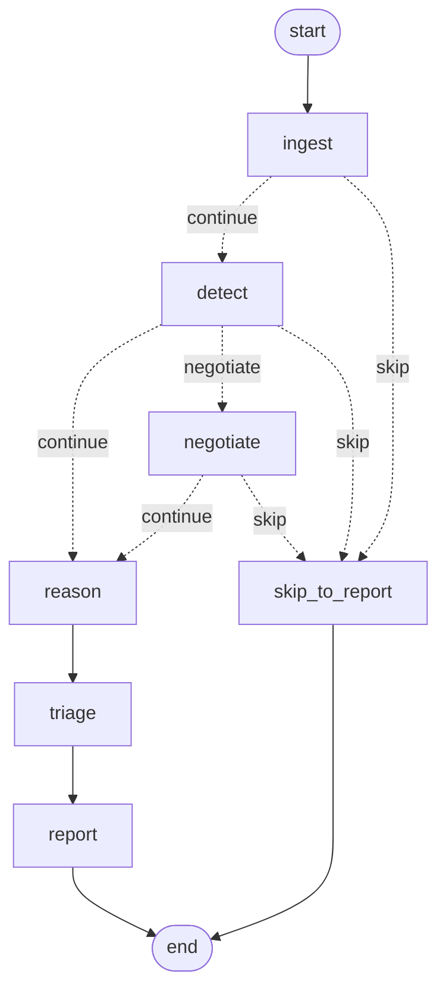

# Autonomous Cybersecurity Analyst AI — A2A Architecture, Protocol & Resilience Specification

**Revision:** 2.0 (A2A + structured protocol + multi-tier fallback + cryptographic tamper-proofing)
**Supersedes:** the Mid-1 linear-pipeline design in `Document/architecture.md` §2–§4
**Status:** implemented and covered by 103 passing tests

---

## 0. What changed, in one paragraph

The Mid-1 system was four functions called in a fixed order, exchanging Python
objects through the orchestrator's local variables, with a single bare
`try/except` standing in for resilience and a bare `sha256()` standing in for
integrity. Revision 2.0 replaces all four of those with real mechanisms: agents
exchange **signed, addressed, correlated Pydantic envelopes over a capability-routed
bus**; two edges that were hardcoded imports are now **peer-to-peer request/response
exchanges**; LLM failures degrade through **four named tiers** instead of silently
dismissing findings; and every artifact, message and audit entry is **salted and
hash-chained**, so tampering, replay and state spoofing are detectable rather than
merely unlikely.

---

## 1. Architecture & Agent-to-Agent Data Flow

### 1.1 Components

| Layer | Module | Responsibility |
|---|---|---|
| Protocol | `analyst/protocol/envelope.py` | `AgentMessage` envelope + payload schema registry |
| Protocol | `analyst/protocol/bus.py` | Capability routing, delivery, integrity/replay enforcement |
| Protocol | `analyst/protocol/crypto.py` | Salt lifecycle, sealing, audit hash chain, report checksums |
| Agent | `analyst/ingestion/agent.py` | Walk + parse + **seal** the repo; decide SUFFICIENT/INSUFFICIENT |
| Agent | `analyst/detection/agent.py` | Rule engine; decide WORTH_ESCALATING/LOW_SIGNAL/NONE_FOUND; **serve `rule.recheck`** |
| Agent | `analyst/reasoning/patch_loop.py` | propose→act→observe→decide patch loop; **serve negotiation** |
| Agent | `analyst/triage/agent.py` | Assign each confirmed finding a fix priority P1–P4 and a rank; **serve `finding.triage`**; deterministic scoring with a validated-scorer seam and deterministic fallback |
| Agent | `analyst/reporting/agent.py` | Render + triage into CLEAN/AUTO_RESOLVED/REVIEW_REQUIRED |
| Shared | `analyst/common/types.py` | `ConfirmedFinding`, `CandidateFinding`, status and tier constants (so Reporting and the orchestrator do not import Reasoning for types) |
| Shared | `analyst/common/redact.py`, `parallel.py` | Secret redaction/scrubbing; order-preserving chunked thread pool |
| Rules | `analyst/detection/engine.py`, `rules_extra.py`, `rules.yaml` | Rule implementations and the rule catalogue (a test keeps catalogue and code in sync) |
| Export | `analyst/reporting/export.py` | Markdown → HTML / PDF (stdlib only); Markdown stays the checksummed artifact |
| Resilience | `analyst/reasoning/fallback.py` | Failure classification, circuit breaker, local rules, patch templates |
| Orchestrator | `analyst/orchestrator/pipeline.py` | Linear coordinator over the bus |
| Orchestrator | `analyst/orchestrator/graph.py` | Same coordination as an explicit LangGraph `StateGraph` |

### 1.2 Capability registry

Agents register *what they can do*, not *who they are*. Callers resolve a
capability; the bus picks the provider. This is the decoupling: no agent imports
another agent's implementation to get work done.

| Capability | Provider | Consumers |
|---|---|---|
| `repo.ingest` | INGEST | ORCHESTRATOR |
| `rule.scan` | DETECT | ORCHESTRATOR |
| `rule.recheck` | DETECT | **REASON**. `patch_loop.py` has no import of the Detection agent; every recheck is a bus request. A caller that passes no bus (unit tests, library use) gets a private bus from the orchestrator wiring (`_local_bus`), so the path is the same. |
| `patch.reasoning` | REASON | **ORCHESTRATOR** (negotiation) |
| `finding.triage` | TRIAGE | ORCHESTRATOR (between REASON and REPORT) |
| `report.render` | REPORT | ORCHESTRATOR |

### 1.3 Control-flow graph



Reproduce with:

```bash
python -c "from analyst.orchestrator.graph import get_graph; print(get_graph().get_graph().draw_mermaid())"
```

The `negotiate` node is the load-bearing one for the "not a hardcoded pipeline"
claim: the edge taken after `detect` depends on a **message another agent sends
back at runtime**, not on a constant in the orchestrator.

### 1.4 Message flow for a full run

```
ORCHESTRATOR   creates SaltContext + AuditLog + MessageBus
   ├─ register INGEST / DETECT / REASON / REPORT  → CAPABILITY_ANNOUNCE ×4 (transcript only)
   │
INGEST  ──DECISION──▶ ORCHESTRATOR      {SUFFICIENT, parse_ratio, manifest_digest}
INGEST  ──STATE_HANDOFF──▶ DETECT       {state_digest = manifest_digest}
   │
DETECT  ──DECISION──▶ ORCHESTRATOR      {WORTH_ESCALATING | LOW_SIGNAL | NONE_FOUND}
   │
   ├── if LOW_SIGNAL:
   │      ORCHESTRATOR ──NEGOTIATION_REQUEST──▶ REASON
   │      REASON ──NEGOTIATION_RESPONSE──▶ ORCHESTRATOR   {accepted, counter_proposal}
   │      └── declined ⇒ route to skip_to_report
   │
DETECT  ──STATE_HANDOFF──▶ REASON       {state_digest = candidates_digest}
   │
   │   per finding, per attempt (1..MAX_ATTEMPTS):
   │      REASON ──PEER_VALIDATION_REQUEST──▶ DETECT   {rule_id, file, sandbox_root, attempt}
   │      DETECT ──PEER_VALIDATION_RESPONSE──▶ REASON  {still_fires, verdict, evidence}
   │      REASON ──FALLBACK_NOTICE──▶ ORCHESTRATOR     (only when a tier degrades)
   │
REASON  ──DECISION──▶ ORCHESTRATOR      {VERIFIED | PARTIALLY_VERIFIED, tiers[]}
   │
ORCHESTRATOR ──TRIAGE_REQUEST──▶ TRIAGE   {items: severity, loop_status, location (no source, no patch text)}
TRIAGE ──TRIAGE_RESPONSE──▶ ORCHESTRATOR  {verdicts: priority + rank + rationale, method}
TRIAGE ──DECISION──▶ ORCHESTRATOR       {TRIAGED | TRIAGED_FALLBACK}
   │
REPORT  ──DECISION──▶ ORCHESTRATOR      {CLEAN | AUTO_RESOLVED | REVIEW_REQUIRED, report_digest}
   │
ORCHESTRATOR   verify_transcript() → seal report → write audit_log.json
```

Message count scales with the number of findings (each one adds peer-validation
request/response pairs per attempt). Offline runs of the seeded demo apps produce
**37 signed messages** for `demo_app` (14 findings) and **29** for `demo_app_jsts`
(14 findings, no auto-patches), identical under the linear and graph orchestrators.
TRIAGE accounts for 4 of each total (capability announce, request, response, decision).

### 1.5 The three genuine A2A interactions

1. **State handoff** — `STATE_HANDOFF` carries a *digest*, not the data. The data
   stays in-process; the digest is what the receiver can check. A swapped or
   replayed state object is detectable.
2. **Peer validation** — REASON cannot grade its own patches. It asks whoever
   provides `rule.recheck`. The verdict arrives as a signed, correlated message
   that lands in the audit chain, so "did the agent mark its own homework?" is
   answerable with evidence.
3. **Negotiation** — REASON owns its own LLM budget. When DETECT reports
   `LOW_SIGNAL`, the orchestrator *asks* rather than *decides*, and routes on the
   reply.

### 1.6 Parallelism inside agents

INGEST and DETECT split their file list into contiguous chunks, run the chunks on a
`ThreadPoolExecutor` and concatenate results **in chunk order**, so output is
identical to a sequential run (`workers=1`); `tests/test_parallel_equivalence.py`
asserts equality of manifest, sources, ASTs and findings, including order. Each
worker has its own tree-sitter parser (parsers are not shared across threads).
This is concurrency *within* an agent. Agent-to-agent traffic still goes through
the single synchronous bus. Because of the GIL, the gain on small repositories is
small; the claim is deterministic parallel structure, not a measured speed-up.

### 1.6a TRIAGE

Placed between REASON and REPORT, reached only through the bus (`finding.triage`). It
sees severity, patch-loop status and location, never source code or patch text. Scoring
is deterministic: base score by severity, plus one when no verified fix exists, mapped
to P1–P4, with a total order for ranks (ties broken by severity, file, line). The effect
is that an open critical issue outranks a critical issue that already has a verified fix,
which plain severity sorting would not do. The report lists findings in fix-first order
with a `Fix priority` line.

It makes **no LLM call**. A `scorer` callable can be injected; its output is accepted only
if it is exactly one well-formed verdict per finding, and any exception or malformed
output falls back to the deterministic scorer, recorded as `method=deterministic_fallback`
with the reason. A missing provider or bus error yields no priorities and the scan
continues (`tests/test_triage_agent.py`). The dashboard has no card for it: TRIAGE
messages appear in the terminal stream only.

### 1.7 Report pipeline and secret handling

Detection redacts secrets in snippets at the point of detection. A patch diff,
however, quotes the original line, so the patch loop applies the real diff to the
sandbox but everything **written out** (report text, `confirmed_findings.json`) is
passed through `scrub_text()` first. The rendered HTML and PDF are produced from
the already-scrubbed Markdown, and `tests/test_export.py` asserts no raw secret
appears in any of them.

---

## 2. Formal Specification of the Inter-Agent Communication Protocol

### 2.1 Envelope

```python
class AgentMessage(BaseModel):
    model_config = ConfigDict(extra="forbid")

    protocol_version: str  = "1.0"
    message_id:       str  # uuid4, single-use per run
    correlation_id:   str  # stable across a request/response conversation
    causation_id:     str | None  # message_id of the message that caused this one

    run_id:           str
    sender:           AgentID          # never BROADCAST
    receiver:         AgentID
    message_type:     MessageType

    payload_type:     str              # registered schema id
    payload:          dict[str, Any]   # validated against payload_type at construction

    created_at:       float
    ttl_seconds:      float = 900.0

    integrity:        MessageIntegrity | None
```

```python
class MessageIntegrity(BaseModel):
    algorithm:        str    # "sha256-salt-prefix" | "hmac-sha256"
    salt_fingerprint: str    # 16 hex chars, non-secret salt identifier
    payload_digest:   str    # seal over the payload alone (cheap partial check)
    signature:        str    # seal over the FULL semantic content (authoritative)
    sealed_at:        float
```

### 2.2 Addresses and verbs

`AgentID` — `ORCHESTRATOR`, `INGEST`, `DETECT`, `REASON`, `REPORT`, `BROADCAST`
(receiver-only).

| `MessageType` | Direction | Payload schema |
|---|---|---|
| `DECISION` | agent → ORCHESTRATOR | `agent.decision.v1` |
| `STATE_HANDOFF` | agent → agent | `agent.state_handoff.v1` |
| `PEER_VALIDATION_REQUEST` | REASON → DETECT | `validation.rule_recheck.request.v1` |
| `PEER_VALIDATION_RESPONSE` | DETECT → REASON | `validation.rule_recheck.response.v1` |
| `NEGOTIATION_REQUEST` | ORCHESTRATOR → REASON | `negotiation.request.v1` |
| `NEGOTIATION_RESPONSE` | REASON → ORCHESTRATOR | `negotiation.response.v1` |
| `CAPABILITY_ANNOUNCE` | agent → BROADCAST | `capability.announce.v1` |
| `FALLBACK_NOTICE` | REASON → ORCHESTRATOR | `resilience.fallback_notice.v1` |
| `ERROR` | agent → ORCHESTRATOR | `error.v1` |

### 2.3 Payload schemas

| Schema | Fields |
|---|---|
| `agent.decision.v1` | `decision: str`, `reason: str`, `metrics: dict`, `artifact_digests: dict` |
| `agent.state_handoff.v1` | `stage`, `summary`, `item_count`, `state_digest`, `manifest_digest?` |
| `validation.rule_recheck.request.v1` | `rule_id`, `file`, `sandbox_root`, `attempt`, `patched_source_digest?` |
| `validation.rule_recheck.response.v1` | `rule_id`, `file`, `still_fires: bool`, `verdict`, `evidence`, `candidates_seen` |
| `negotiation.request.v1` | `proposal`, `rationale`, `context: dict` |
| `negotiation.response.v1` | `accepted: bool`, `rationale`, `counter_proposal?`, `conditions: list` |
| `capability.announce.v1` | `agent`, `capabilities: list[str]` |
| `resilience.fallback_notice.v1` | `tier_from`, `tier_to`, `trigger`, `detail`, `recoverable` |
| `error.v1` | `error_class`, `detail`, `fatal` |

Machine-readable JSON Schema for all nine:

```python
from analyst.protocol import registered_payload_schemas
registered_payload_schemas()   # {schema_name: JSON Schema}
```

### 2.4 Design rules (and why)

| Rule | Rationale |
|---|---|
| `payload` is a dict tagged with `payload_type`, validated via a registry | A `Union` of payload models makes Pydantic's smart-union guess, and it picks wrong when two payloads share field names. Schema-id + registry is how versioned wire protocols actually work. |
| Every payload model sets `extra="forbid"` | In a security tool, a field the receiver ignores is a field an attacker can smuggle state in. |
| The signature covers **addressing**, not just the body | Otherwise a validly-sealed message could be re-addressed to a different agent unchanged. |
| `seal()` refuses to run twice | Re-sealing means the message was mutated after sealing — a bug, not a retry. |
| `to_legacy_dict()` keeps `agent`/`decision`/`reason`/`timestamp` | The dashboard, CLI and 22 pre-existing tests read those keys. Protocol fields are purely additive. |

### 2.5 Bus admission control

Every message passes five gates before delivery. Any failure is recorded in
`bus.rejected` and the audit chain.

| # | Gate | Defends against |
|---|---|---|
| 1 | `run_id` matches the bus's run | Cross-run injection |
| 2 | Not past `ttl_seconds` | Stale-message replay |
| 3 | `message_id` not seen before in this run | Replay of a perfectly valid message |
| 4 | `payload_digest` verifies | Payload tampering |
| 5 | `signature` verifies | Tampering + re-addressing + spoofing |

---

## 3. Failover & Recovery Matrix

### 3.1 Tiers

| Tier | Name | Behaviour |
|---|---|---|
| **T0** | `T0_LLM` | Groq structured-output call |
| **T1** | `T1_LLM_RETRY` | Bounded retry, exponential backoff + full jitter |
| **T2** | circuit open | Remaining findings skip the LLM entirely |
| **T3** | `T3_DETERMINISTIC` | Local regex confirmation + static severity + template patches |
| **T4** | `T4_MANUAL_REVIEW` | Human review with safe default remediation advice |

### 3.2 LLM failure matrix

| Trigger | `FailureClass` | Detection | Retry? | Route | Recovery |
|---|---|---|---|---|---|
| HTTP 429 / "rate limit" | `RATE_LIMIT` | `status_code` or regex | Yes (≤3) | T1 → T3 | Breaker closes on any success |
| Read/connect timeout | `TIMEOUT` | `status_code` 408/504, `TimeoutError`, regex | Yes | T1 → T3 | as above |
| DNS / socket / TLS | `CONNECTIVITY` | `ConnectionError`/`OSError`, regex | Yes | T1 → T3 | as above |
| HTTP 5xx / overloaded | `SERVER` | `status_code`, regex | Yes | T1 → T3 | as above |
| HTTP 401/403, bad key | `AUTH` | `status_code`, regex | **No** | T3 immediately | Breaker opens on the **first** failure |
| Quota/credit exhausted | `QUOTA` | regex | **No** | T3 immediately | Breaker opens immediately |
| Malformed/empty model output | `SCHEMA` | missing `confirmed` key | Yes | T1 → T3 | as above |
| Unrecognised exception | `UNKNOWN` | default | No | T3 | — |
| `GROQ_API_KEY` unset | — | env check | n/a | T3 for the whole run | Set the key |
| `--offline` | — | explicit flag | n/a | T3 for the whole run | Drop the flag |

Circuit breaker: opens after **3** consecutive transient failures, or **1**
`AUTH`/`QUOTA` failure. `HALF_OPEN` after `reset_after` (60 s default) allows one
probe; success closes it.

Backoff: `min(8.0, 0.5 · 2^(n−1))` with **full jitter** (uniform in `[0, delay]`).
Full jitter rather than fixed backoff because with fixed backoff every worker
that hit the same 429 retries at the same instant and re-trips the limit.

### 3.3 Patch validation matrix

| Trigger | Detection | Route | Resulting state |
|---|---|---|---|
| Patch applies, rule cleared, confidence ≥ `verified_narrow` | Peer validation from DETECT | **ACCEPT** | `ACCEPTED` |
| Patch does not apply (anchor text absent), attempts left | `PatchApplyError` | **RETRY** with failure feedback | loop continues |
| Rule still fires, attempts left | `still_fires=True` | **RETRY** with failure feedback | loop continues |
| Patch syntactically invalid | `ast.parse` in `confidence.py` | `tier="unverified"` → retry/escalate | — |
| Attempts exhausted | `attempt_num == MAX_ATTEMPTS` | **T4** | `MANUAL_REVIEW_REQUIRED`, `patch_diff=None`, `remediation_advice` set |
| LLM confirms but proposes no patch | empty `patch_diff` | **T4-lite** | `SKIPPED_NO_PATCH` + advice |
| Sandbox re-scan itself raises | exception in `recheck_rule` | **fail closed** | `verdict=INDETERMINATE`, `still_fires=True` |
| Peer does not answer | `NoRouteError` | **raise** | never read as "all clear" |

**Fail-closed is the invariant.** An unverifiable patch is treated as unresolved,
never as resolved. `MANUAL_REVIEW_REQUIRED` sets `patch_diff = None` so no
unverified diff can reach the report as a fix.

### 3.4 The regression this fixes

Before: `analyze_finding` wrapped the Groq call in a bare `except Exception` and
returned `confirmed=False, "LLM call failed"`. A 429 on the third finding
silently downgraded a real SQL injection to a non-finding, and the report looked
identical to a genuinely clean scan. **A security scanner that fails open is
worse than one that crashes, because the failure is invisible.** Covered by
`tests/test_fallback_tiers.py::test_persistent_rate_limit_falls_back_to_local_rules_not_to_dismissal`.

### 3.5 Deterministic patch templates

| Rule | Transform |
|---|---|
| `SQLI-001` | `q = f"… '{x}' …"` + `execute(q)` → parameterised query + `q_params` tuple + `execute(q, q_params)` |
| `XSS-002` | `return f"<div>{x}</div>"` → `return "<div>" + escape(x) + "</div>"` (+ `from markupsafe import escape`) |
| `SECRET-005` | `KEY = "literal"` → `KEY = os.environ["KEY"]` (+ `import os`) |

Templates decline (`None`) rather than guess when the placeholder contains an
expression, the file is not Python, or no template exists for the rule — which
routes the finding to T4. They are safe to offer because they pass through the
**same** verification gate as LLM patches: applied to a sandbox, re-scanned by
the real detection engine, rejected if the rule still fires.

On `demo_app` with no API key at all, T3 auto-fixes **2 of 3** findings and sends
the third to manual review.

> **Note:** `XSS-002` keys on the f-string-with-tag shape, so wrapping the
> variable as `f"<div>{escape(x)}</div>"` would still fire the rule. The template
> removes the f-string entirely. This is the kind of detail that only surfaces
> when patches are actually re-verified rather than trusted.

### 3.6 Visibility

Degradation is never silent. Every tier transition emits a `FALLBACK_NOTICE` on
the bus, which surfaces in four places: the CLI (`[!] DEGRADED RUN`), the report
header (`> **Degraded run.**`), each finding's `analysis_tier`, and the
`REVIEW_REQUIRED` decision text.

---

## 4. Cryptographic Design Specification

### 4.1 Threat model

| Threat | Before | Now |
|---|---|---|
| **Tampering** — edit a finding, recompute the hash | Trivial: `sha256()` is public | Needs the run salt |
| **Replay** — resubmit a manifest from an earlier run | Undetectable: identical digest | Different salt ⇒ verification fails |
| **State spoofing** — fabricate a finding + matching digest | Trivial | Needs the run salt |
| **Audit rewriting** — delete an inconvenient entry | No chain existed | Breaks the hash chain at that seq |
| **Report edit in transit** — change CRITICAL to LOW | Undetectable | Sidecar checksum fails |

### 4.2 Salt lifecycle

```
salt = sha256( "v1" | pepper | run_id | nonce | epoch )[:32]
```

| Input | Source | Secret? |
|---|---|---|
| `pepper` | `$ANALYST_HASH_PEPPER`, SHA-256'd. If unset, 32 random bytes generated per process and **never persisted** | **Yes** |
| `run_id` | Caller-supplied (e.g. FastAPI job id) or `run_<ts>_<rand>` | No |
| `nonce` | 16 random bytes per run, recorded in the descriptor | No |
| `epoch` | 0, incremented by `rotate()` | No |

**Ephemeral vs configured pepper.** With no pepper set, digests verify *within*
the run — which is all the agent protocol needs — but not after a restart. With
`ANALYST_HASH_PEPPER` set, a verifier can rebuild the salt from the public
descriptor (`run_id`, `nonce`, `epoch`) and validate a report months later.
**Set the pepper in any deployment where reports must be independently
verifiable.** `descriptor()["pepper_source"]` reports which mode is active.

### 4.3 Hashing modes

| Mode | Construction | Notes |
|---|---|---|
| `sha256-salt-prefix` *(default)* | `sha256(salt ‖ content)` | Exactly the construction specified in the requirement |
| `hmac-sha256` | `HMAC-SHA256(salt, content)` | Cryptographically correct keyed digest |

> **Architectural note, stated plainly.** The naive `sha256(salt ‖ content)`
> prefix form is vulnerable to **length extension**: an attacker holding a valid
> digest for content `C` can compute a valid digest for `C ‖ padding ‖ suffix`
> *without knowing the salt*. Our payloads are canonical JSON, so appended bytes
> would not parse and the attack is impractical here — but the weak construction
> should not be presented as best practice. Both are implemented; the spec'd one
> is the default so the implementation matches what is being graded. Switch with
> `ANALYST_HASH_MODE=hmac-sha256`. **This is a good Q&A answer to have ready.**

### 4.4 Tagged digest format

```
v1:sha256-salt-prefix:0:23819ef49e352e97…
│   │                  │  └─ 64 hex chars
│   │                  └──── salt epoch
│   └─────────────────────── mode
└─────────────────────────── hash version
```

The tag is what makes rotation possible: a verifier never has to guess which
construction or which salt generation produced a value. Unknown version or mode
⇒ **refuse to verify**, never guess.

### 4.5 Canonicalisation

`canonical_bytes()` = `json.dumps(sort_keys=True, separators=(",",":"), ensure_ascii=False)`.
Without this, a payload that round-trips JSON with a different key order fails
its own signature check.

### 4.6 What gets sealed

| Artifact | Sealed content | Where |
|---|---|---|
| File entry | `{path, content}` — **both** | `FileEntry.salted_digest` |
| Manifest | sorted `path:digest` list | `IngestionManifest.manifest_digest` |
| Candidate findings | full JSON list | `candidates_digest` in the DETECT decision |
| Message payload | payload dict | `MessageIntegrity.payload_digest` |
| Message (full) | addressing + correlation + payload + timestamps | `MessageIntegrity.signature` |
| Audit entry | `{seq, ts, actor, action, details, prev_hash}` | `AuditEntry.entry_hash` |
| Report | exact bytes written | `report.md.integrity.json` |

**Why the file digest binds path *and* content:** hashing content alone would let
an attacker move a benign file's digest onto a malicious path and keep the
manifest self-consistent.

**Why the manifest digest sorts first:** filesystem walk order must never change
the digest for an identical tree.

### 4.7 Audit chain

```
genesis    = seal({genesis: stream_id, run_id})
entry[n]   = seal({seq, timestamp, actor, action, details, prev_hash: entry[n-1].hash})
```

Removing, reordering or editing any entry invalidates every hash after it.
Because the digest is *salted*, an attacker with write access to `audit_log.json`
cannot recompute a valid chain. That is the difference between **tamper-evident**
and merely **checksummed**.

```python
ok, note = audit.verify()
# (False, "Chain break at seq=1: prev_hash does not match …")
# (False, "Entry seq=0 (DETECT/DECISION) fails its salted digest …")
```

### 4.8 Rotation

`SaltContext.rotate()` retires the current salt into an in-memory map keyed by
epoch and derives the next one. Already-sealed artifacts keep verifying via their
epoch tag; new seals use the new salt. **Rotation that invalidated history would
mean nobody ever rotates.**

Rotate on: each new pipeline run (automatic — a fresh context per run), a
long-running server crossing its rotation interval, or any suspicion the salt
leaked.

### 4.9 Tamper-detection flow

```
1. INGEST seals every file; manifest.verify() runs immediately
      └─ mismatch ⇒ decision = INSUFFICIENT (fail closed, pipeline stops)
2. Every message sealed on send, verified on delivery
      └─ failure ⇒ IntegrityError, message dropped, logged to bus.rejected + audit
3. Every routing decision appended to the salted audit chain
4. End of run: bus.verify_transcript() re-verifies all messages + the chain
      └─ failure ⇒ status downgraded to PARTIAL, stage_errors["INTEGRITY"]
5. Report sealed into report.md.integrity.json
```

Step 4 is the one worth defending: **a run whose own message log does not verify
cannot vouch for its findings**, so it is never reported as `OK`.

---

## 5. Setup & Execution Guide

### 5.1 Install

```bash
cd cybersecurity-analyst-ai
python -m venv venv && source venv/bin/activate      # Windows: venv\Scripts\activate
pip install -r requirements.txt
```

No new dependencies. `pydantic>=2.0.0` was already present; `hashlib`, `hmac`,
`secrets` and `json` are stdlib.

### 5.2 Configure

```bash
cp .env.example .env
```

```ini
# .env — never commit this file
GROQ_API_KEY=gsk_your_key_here

# Optional. Without it, salts are per-process and reports are not verifiable
# after a restart. Set it in anything resembling a deployment.
ANALYST_HASH_PEPPER=some-long-random-deployment-secret

# Optional. Default is sha256-salt-prefix (the spec'd construction).
ANALYST_HASH_MODE=hmac-sha256
```

> **Before anything else:** `.env` is currently committed and `.env.example`
> contains a live-looking key. See §6.

### 5.3 Run

```bash
# Linear orchestrator (default)
python -m analyst scan demo_app -o report.md --artifacts artifacts/

# LangGraph orchestrator — same agents, same decisions, graph-expressed routing
python -m analyst scan demo_app --engine graph -o report_graph.md --artifacts artifacts_graph/

# Deterministic tier only — no API key needed. This is the fallback demo.
python -m analyst scan demo_app --offline -o report_offline.md --artifacts artifacts_offline/

# Report format: md (default) | html | pdf. Markdown is always written and is what
# the integrity sidecar covers; html/pdf are rendered from it next to it.
python -m analyst scan demo_app --offline -o report.md --format pdf     # report.md + report.pdf

# Remote target
python -m analyst scan https://github.com/user/repo -o report.md
```

### 5.4 Outputs

| Path | Contents |
|---|---|
| `report.md` | The rendered report |
| `report.md.integrity.json` | Salted checksum, salt descriptor, audit head |
| `artifacts/ingestion_manifest.json` | Per-file salted digests + manifest digest |
| `artifacts/candidate_findings.json` | Raw rule-engine output |
| `artifacts/confirmed_findings.json` | Verdicts, loop status, attempt log, `analysis_tier` |
| `artifacts/audit_log.json` | Hash-chained audit trail |

### 5.5 Tests

```bash
# Everything (148 tests at the time of writing; the count changes as tests are added)
pytest test_*.py tests/ -q

# Root-level suite (22)
pytest test_*.py -q

# tests/ directory (126)
pytest tests/ -q

# By requirement
pytest tests/test_a2a_bus.py -v            # req 1: A2A decoupling
pytest tests/test_protocol_envelope.py -v  # req 2: structured protocol
pytest tests/test_fallback_tiers.py -v     # req 3: multi-tier fallback
pytest tests/test_protocol_crypto.py -v    # req 4: salting & tamper-proofing
```

### 5.6 Manual verification

```bash
# Confirm a report has not been edited since the scan
python - <<'PY'
import json
from pathlib import Path
print(json.loads(Path("report.md.integrity.json").read_text())["checksum"])
PY

# Confirm the audit chain is intact
python - <<'PY'
import json
from pathlib import Path
log = json.loads(Path("artifacts/audit_log.json").read_text())
print(len(log["entries"]), "entries, head:", log["head"][-16:])
PY

# Dump the protocol contract
python -c "import json; from analyst.protocol import registered_payload_schemas; print(json.dumps(registered_payload_schemas(), indent=2))"

# Render the routing graph
python -c "from analyst.orchestrator.graph import get_graph; print(get_graph().get_graph().draw_mermaid())"
```

### 5.7 Demonstrating each requirement live

| Requirement | Command | What to point at |
|---|---|---|
| 1 — A2A | `python -m analyst scan demo_app --offline` | `REASON -> DETECT [PEER_VALIDATION_REQUEST]` in the live feed |
| 2 — Protocol | `python -c "import json; from analyst.protocol import registered_payload_schemas as s; print(json.dumps(s(), indent=2))"` | 9 enforced schemas |
| 3 — Fallback | `python -m analyst scan demo_app --offline` | `[!] DEGRADED RUN`, 2 of 3 auto-fixed with no LLM |
| 4 — Crypto | edit `report.md`, re-verify against the sidecar | Checksum fails |

---

## 6. Security finding in this repository

Found while reading the code, and more urgent than any of the four enhancements:

1. **`.env` is committed** and **`.gitignore` is 0 bytes.**
2. **`.env.example` contains what appears to be a real Groq key** (`gsk_WF0b…`).

Remediation:

```bash
# 1. Revoke the key at console.groq.com — assume it is compromised.
# 2. Create a real .gitignore
printf '.env\nvenv/\n__pycache__/\n*.pyc\n.pytest_cache/\napi_runs/\nartifacts/\n*.integrity.json\n' > .gitignore
# 3. Untrack the secret
git rm --cached .env
# 4. Purge it from history — a delete commit does NOT remove it
pip install git-filter-repo && git filter-repo --path .env --invert-paths
# 5. Put a placeholder in .env.example, never a real value
echo 'GROQ_API_KEY=gsk_your_key_here' > .env.example
```

This is worth one slide. A security tool that leaks its own credentials is the
kind of detail a panel remembers — and handling it openly is a much stronger
answer than hoping nobody looks.

---

## 7. Limitations (state these before you are asked)

### 7.1 Known limitations

- **Single process.** All agents run in one Python process and the bus is a synchronous in-memory
  router. Agents are separated by capability contracts and signed envelopes, not by process or
  network boundaries. Nothing here has been run distributed, and thread pools inside INGEST/DETECT
  do not change that.
- **Only REASON uses an LLM.** INGEST, DETECT, REPORT and the orchestrator are deterministic code.
  The "multi-agent" claim rests on separated responsibilities, capability-routed messaging and
  peer validation, not on several LLMs collaborating. Without a key, REASON itself falls back to a
  deterministic tier.
- **Ephemeral pepper means tamper-evidence only.** Unless `ANALYST_HASH_PEPPER` is set, the pepper
  is random per process and never stored. Digests and the audit chain detect modification *within
  that run*. They cannot be re-verified after a restart, and they prove neither which agent
  produced a message nor authenticity to a third party (shared symmetric salt, no signatures).
- **Rule coverage is partial.** `rules.yaml` lists what is implemented and what is not
  (XSS-004, AUTH-003, AUTH-004, SSRF-001, SECRET-004, SECRET-008 are specified but not built).
  XSS-003, AUTH-001 and SECRET-006 are heuristics and can false-positive. SECRET-007 only fires
  in files of an ingested language, not in a standalone `.pem`.
- **Metrics are on seeded apps.** Ground truth is the seeded set the rules were written against and
  the apps contain no benign look-alikes, so recall is optimistic and REASON's false-positive
  filtering is not exercised. See `metrics.md`.
- **Patch templates are Python-only** (see 7.2).

### 7.2 Design trade-offs (deliberate)

| Limitation | Why it is acceptable here | What would change at scale |
|---|---|---|
| Bus is synchronous and in-process | Four bounded agents in one process; a broker adds deployment surface with no behavioural gain. The envelope is transport-agnostic JSON, so the swap is a bus change, not a protocol redesign. | Redis/NATS broker, async handlers |
| Symmetric salt, not asymmetric signatures | All agents are in one trust domain. A salt proves *this run produced this*, which is the property needed. | Per-agent Ed25519 keys; signatures would prove *which agent* |
| Ephemeral pepper by default | Zero-config correctness for a student demo | Pepper from a secret manager, mandatory |
| `MAX_ATTEMPTS = 2` | Bounded retries prevent runaway free-tier usage; bounding is itself a safety property | Budget-aware, per-severity attempt limits |
| Patch templates are Python-only | The three implemented rule families with fixtures are Python | JS/TS templates once those fixtures exist |
| Retry loop is not a graph cycle | It is one agent's internal verification step, not inter-agent routing | Graph-level cycles with recursion limits |
| `sha256(salt‖content)` default | Matches the specified construction; HMAC is implemented and one env var away | HMAC as default |

---

## 8. Test coverage map

| File | Tests | Covers |
|---|---|---|
| `tests/test_a2a_bus.py` | 13 | Capability routing, peer validation, negotiation, replay/tamper/expiry/cross-run defence |
| `tests/test_protocol_envelope.py` | 17 | Schema enforcement, signature scope, correlation, legacy projection |
| `tests/test_fallback_tiers.py` | 31 | Classification, breaker, backoff, T1→T3 degradation, T4 manual review |
| `tests/test_protocol_crypto.py` | 20 | Salting, rotation, manifest digest, audit chain, report sealing |
| `tests/test_bus_only_peer_validation.py` | 2 | REASON has no Detection import; bus-less calls still route via `rule.recheck` |
| `tests/test_common_types.py` | 3 | Shared types and legacy import paths |
| `tests/test_parallel_equivalence.py` | 6 | Parallel INGEST/DETECT output equals sequential |
| `tests/test_rule_registry.py` | 3 | `rules.yaml` matches code; new rules fire / skip; no raw secret |
| `tests/test_seeded_rules.py` | 7 | Demo apps: detections equal ground truth, SAFE lines silent, no raw secret |
| `tests/test_compute_metrics.py` | 2 | Metrics script consistency |
| `tests/test_triage_agent.py` | 13 | Priority scoring, determinism, scorer validation and fallback, capability registration, placement between REASON and REPORT in both engines, identical priorities across engines |
| `tests/test_export.py` | 9 | `--format`, HTML escaping, PDF validity, no raw secret in md/html/pdf/artifacts |
| `test_*.py` (root) | 22 | Earlier regression suite (3 files adjusted for the larger demo app) |
| **Total** | **148** | |
