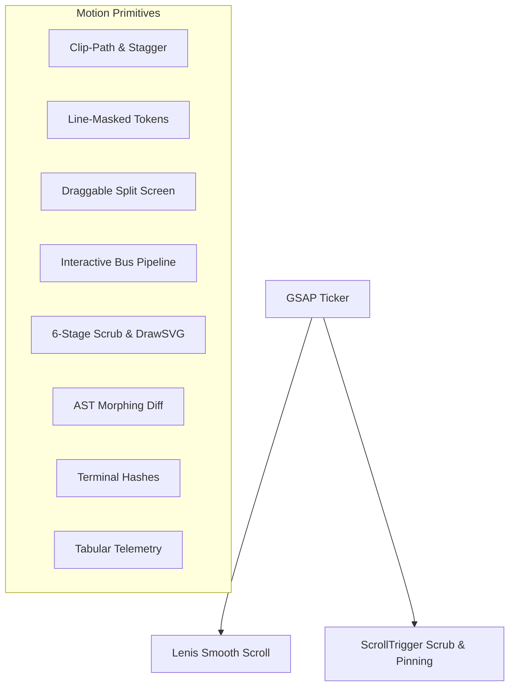

# Autonomous Cybersecurity Analyst AI — Frontend Documentation

Studio-grade Next.js (App Router) precision instrument frontend engineered for the **Autonomous Cybersecurity Analyst AI** Final Year Project (FYP).

---

## 1. Quick Start

### Development Server
```bash
npm install
npm run dev
# Opens at http://localhost:3000
```

### Production Build & Launch
```bash
npm run build
npm run start
```

---

## 2. Design System & Anti-Slop Discipline

Authored strictly according to precision studio guidelines:
- **Canvas & Ink Palette:**
  - Canvas: `#0A0B0D` (Dark Ink) / `#F8F9FA` (Light Parity)
  - Surface: `#111317` (Sheet) / `#181B20` (Subtle)
  - Lines: `rgba(255, 255, 255, 0.08)` (1px precision hairlines)
  - Signal Accent: `#C6FF3D` (Signal-lime, used on <3% of viewport for interactive focal points)
  - Severity: Critical (`#FF4D4D`), High (`#FF9F43`), Medium (`#F5D547`), Low (`#5BC0FF`)
- **Typography:**
  - UI & Body: **Geist** (`font-sans`) — clear legibility, 16px body copy, strict contrast ratio (>4.5:1)
  - Code & Figures: **Geist Mono** (`font-mono`) — tabular numbers (`tabular-nums`), AST query identifiers, HMAC signatures, memory addresses
  - Editorial Emphasis: **Instrument Serif Italic** (`font-serif italic font-normal`) — exactly one word per headline (e.g. "Rules find. AI *explains*.")
- **Anti-Slop Guarantees:**
  - Zero generic 3-card feature rows
  - Zero emoji icons (Lucide icons at consistent 1.5–2px stroke weight)
  - Zero purple/blue gradient mush
  - Zero placeholder "Lorem Ipsum" or "Acme Corp"
  - Real AST rule queries and empirical diff verification data throughout

---

## 3. Motion Architecture (`lib/motion.ts`)

Powered by **GSAP 3** + **`@gsap/react`** (`useGSAP`) with **Lenis** smooth scroll synced to the GSAP ticker.



### Motion Specifications:
- **Signal Ease:** `CustomEase.create("signal", "M0,0 C0.16,1 0.3,1 1,1")` (fast attack out, soft organic settle)
- **Composite-Only Animating:** Animates exclusively `transform`, `opacity`, and `clip-path` (0 layout reflows, 60 FPS)
- **Reduced Motion Support:** Wrapped in `gsap.matchMedia('(prefers-reduced-motion: reduce)')` to automatically swap dynamic scrubs to accessible fades.

---

## 4. Route Architecture

| Route | Layout | Key Components | Purpose |
|---|---|---|---|
| `/` | Marketing | `HeroScene` (R3F), `PinnedPipeline`, `PrincipleCompare`, `LiveCodeDemo`, `MetricsAndTeam` | Kage-style cinematic landing, drifting AST 3D nodes, pinned DrawSVG conduit, draggable rules-vs-LLM compare, live diff morph |
| `/dashboard` | App Shell | Posture score gauge, severity strip, findings trend, AST rule breakdown, recent scans, module health | Real-time security posture telemetry cockpit |
| `/scan/new` | App Shell | Source selector, upload dropzone, rule-pack checkboxes, `--dynamic` and `--offline` flags | Ingestion & scan orchestrator launch console |
| `/scan/[id]` | App Shell | `StageRail`, streaming terminal (`aria-live="polite"`), `ScrambleId` hashes, staggered findings | Live scan cockpit with real-time A2A bus stream |
| `/findings` | App Shell | Sticky filter bar, search, severity chips, hover preview, table | Vulnerability inventory workbench |
| `/findings/[id]` | App Shell | Code viewer, AST sink highlighter, LLM explanation, side-by-side patch diff, sandbox re-check trigger | Detailed vulnerability triage & sandbox patch test |
| `/traffic` | App Shell | 24-hour anomaly heat strip, flagged requests table, payload drill-down panel | Network & log ingress anomaly telemetry |
| `/reports` | App Shell | Report vault list, executive summary viewer, DrawSVG dividers, Markdown & PDF export triggers | Cryptographic report vault with HMAC chain validation |
| `/architecture` | Marketing | Interactive topology node graph, DrawSVG bus conduit, inspectable module drawer | Zero-import capability bus specification |
| `/settings` | App Shell | Groq / Claude / Offline provider selector, API keys, theme toggle, motion engine preference | Runtime engine & environment settings |

---

## 5. Connecting the Real FastAPI Backend

The frontend contains an abstracted API client (`lib/api.ts`) that is swappable via environment variables.

### To Connect to the Python/FastAPI Backend:
1. Start the FastAPI backend:
   ```bash
   uvicorn analyst.api.app:app --port 8000
   ```
2. In `.env.local`:
   ```bash
   NEXT_PUBLIC_USE_REAL_BACKEND=true
   NEXT_PUBLIC_API_URL=http://localhost:8000
   ```
3. Restart the Next.js server (`npm run dev` or `npm run build && npm run start`).

If the backend is not running or network interruptions occur, `lib/api.ts` gracefully falls back to the deterministic security mock store without crashing.

---

## 6. Multi-Viewport Responsive Validation

Screen captures were evaluated across all standard responsive breakpoints using `scripts/inspect.mjs`:
- **Desktop (1440px):** Full L-frame studio shell, floating 3D particle hero, side-by-side patch diff, pinned 6-stage scrub conduit.
- **Tablet (768px):** Collapsible studio navigation, responsive grid re-flow, touch-friendly interactive handles.
- **Mobile (375px):** Drawer navigation, stacked comparison cards (preventing clip-path overlap), optimized 36px headlines, zero horizontal scroll.

Screenshots and inspection reports are located at:
- `.taste-skill/screenshots-landing/`
- `.taste-skill/screenshots-final-app/`

