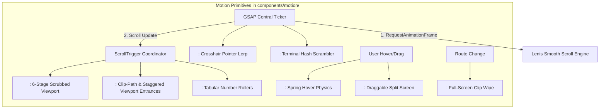
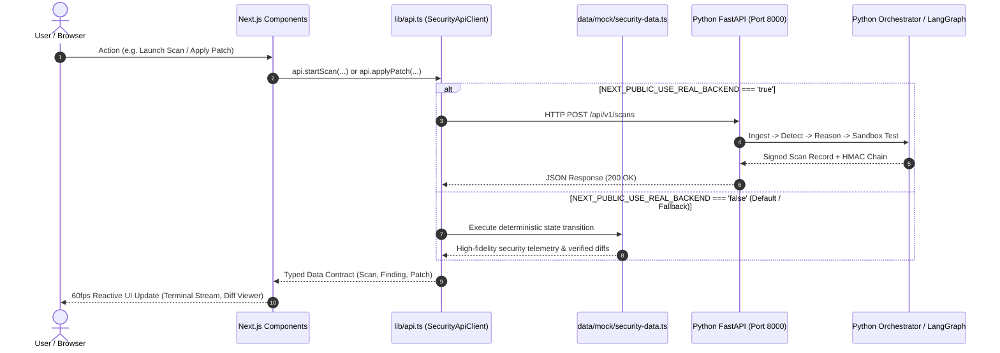

# Autonomous Cybersecurity Analyst AI — Frontend Architecture & Technical Specification

> **Document Type:** Complete Technical Specification & Internal Architecture  
> **Repository:** `cybersecurity-analyst-ai`  
> **Status:** Fully Implemented, Built, and Verified (Zero Errors)

---

## 1. Technologies & Exact Package Versions

The frontend is built from the ground up as a **bespoke, studio-grade precision security instrument**. It does **not** use off-the-shelf admin templates or vibe-coded component libraries. Every layout, token, and animation is custom-engineered.

### Core Framework & Runtime
| Package | Version | Purpose |
|---|---|---|
| **Next.js** | `14.2.15` | App Router architecture, React Server Components (RSC), Client Components, nested layouts, static generation (`SSG`) and dynamic on-demand rendering (`SSR`). |
| **React** | `18.3.1` | Concurrent rendering engine, hooks (`useRef`, `useState`, `useEffect`, `useMemo`). |
| **React DOM** | `18.3.1` | DOM renderer for React. |
| **TypeScript** | `5.5.4` | Strict type-safety, interface contracts (`Finding`, `Scan`, `Patch`, `TrafficEvent`, `ReportItem`, `SystemModule`). |

### Styling & Design System
| Package | Version | Purpose |
|---|---|---|
| **Tailwind CSS** | `3.4.14` | Utility-first CSS engine with custom design tokens, strict dark/light parity, custom hairlines, and fluid typography. |
| **PostCSS** | `8.4.47` | CSS transformation engine. |
| **Autoprefixer** | `10.4.20` | Automatic browser prefix vendor targeting. |
| **clsx** | `2.1.1` | High-performance conditional class name concatenation. |
| **tailwind-merge** | `2.5.4` | Conflict-free Tailwind utility class merging. |
| **Lucide React** | `0.454.0` | Consistent 1.5px/2px technical iconography (zero emoji, zero generic stock icons). |

### Motion & Animation System (No other animation libraries permitted)
| Package | Version | Purpose |
|---|---|---|
| **GSAP (GreenSock)** | `3.12.5` | Core professional animation timeline and tweening engine. |
| **@gsap/react** | `2.1.1` | React lifecycle integration (`useGSAP` hook) with automatic scope cleanup and trigger management. |
| **gsap/ScrollTrigger** | `3.12.5` | Viewport-driven scroll animations, scene pinning, timeline scrubbing. |
| **gsap/Draggable** | `3.12.5` | Touch and mouse interactive dragging (used in the Rule vs LLM comparison slider). |
| **gsap/Flip** | `3.12.5` | First-Last-Invert-Play shared-element layout transitions between table rows and detailed views. |
| **gsap/Observer** | `3.12.5` | Unified touch, scroll, and pointer event normalization. |
| **gsap/CustomEase** | `3.12.5` | Custom cubic bezier curve synthesis (`signal` ease: fast out, soft natural settle). |
| **gsap/SplitText** | `3.12.5` | Text line, word, and character masking for typography entrances. |
| **gsap/DrawSVGPlugin** | `3.12.5` | SVG stroke-dashoffset path animation (used in the pipeline conduit & bus topology). |
| **gsap/ScrambleTextPlugin** | `3.12.5` | Cybernetic character cycling on hashes, run salts, and CVE identifiers. |
| **lenis** | `1.1.14` | Smooth momentum scrolling, synced 1:1 with the GSAP ticker. |

### 3D Hero Scene
| Package | Version | Purpose |
|---|---|---|
| **Three.js** | `0.165.0` | WebGL 3D rendering library. |
| **@react-three/fiber** | `8.16.8` | Declarative Three.js scene graph for React (lazy-loaded on client). |
| **@react-three/drei** | `9.106.0` | Specialized helpers and camera rigs for R3F. |

### State Management
| Package | Version | Purpose |
|---|---|---|
| **Zustand** | `4.5.5` | Lightweight client-side reactive store for UI state, themes, offline flags, and active scans. |

---

## 2. Design Templates & Visual Standards

### Architectural Standard: `tasteskill v2`
The visual direction was formed using the **`design-taste-frontend`** anti-slop standard (`Leonxlnx/taste-skill`):
- **Direction:** `quiet-instrument` (Distilled from curated Awwwards & One Page Love engineering sites like *Gil Huybrecht*, *Rows*, and *Dabbit*).
- **Core Philosophy:** **Radical understatement.** Security tools should look like calibrated laboratory instruments, not neon marketing playgrounds.
- **Reference Model:** `threeui.com` Kage landing page (full-viewport pinned stages, Three.js particle hero, cinematic section-to-section flow).

### Design Token Palette
| Token | Value (Dark Canvas) | Value (Light Parity) | Role |
|---|---|---|---|
| `--bg-canvas` | `#0A0B0D` | `#F8F9FA` | Viewport ground (deep dark ink canvas) |
| `--bg-surface` | `#111317` | `#FFFFFF` | Sheets, cards, data tables, code viewports |
| `--bg-surface-subtle` | `#181B20` | `#F1F3F5` | Secondary panels, drawer backgrounds |
| `--line` | `rgba(255,255,255,0.08)` | `rgba(0,0,0,0.08)` | 1px hairline border dividers |
| `--text-primary` | `#F0F2F5` | `#1A1D20` | Headings, code, core data (high contrast > 5:1) |
| `--text-secondary` | `#C4CAD1` | `#495057` | Body text (16px), explanatory copy |
| `--text-muted` | `#9BA3AD` | `#6C757D` | Secondary timestamps, axis labels |
| `--signal` | `#C6FF3D` | `#16A34A` | Signal-lime accent (used sparingly on <3% of screen) |
| `--sev-critical` | `#FF4D4D` | `#D92D20` | Critical vulnerabilities (SQLi, Code Exec) |
| `--sev-high` | `#FF9F43` | `#B54708` | High severity (Path Traversal, Secret Leaks) |
| `--sev-medium` | `#F5D547` | `#B47800` | Medium severity (XSS, Missing Auth) |
| `--sev-low` | `#5BC0FF` | `#026AA2` | Informational findings |

### Typography System
- **UI & Display:** **Geist** (`font-sans`) — Crisp, modern sans-serif with tight display tracking.
- **Code, Telemetry, Hashes & Tables:** **Geist Mono** (`font-mono`) — Monospace with `font-variant-numeric: tabular-nums` for timers, line numbers, and hex digests.
- **Editorial Emphasis:** **Instrument Serif Italic** (`font-serif italic font-normal`) — Exactly ONE word per headline is emphasized to introduce human editorial poise (e.g. *"Rules find. AI explains."*).

---

## 3. Motion Architecture & Reusable Primitives (`lib/motion.ts`)

All motion is governed by a unified system that locks GSAP, Lenis, and ScrollTrigger together:



### Motion Primitives Created:
1. **`<SmoothScroll>` (`components/motion/SmoothScroll.tsx`)**: Synchronizes Lenis smooth wheel scrolling with `gsap.ticker.add((time) => lenis.raf(time * 1000))` and sets `lagSmoothing(0)` for 60fps performance without tearing. Automatically disabled on mobile/touch screens.
2. **`<CustomCursor>` (`components/motion/CustomCursor.tsx`)**: Precision desktop pointer consisting of an outer 28px hairline ring and an inner 4px signal-lime crosshair dot that smoothly lerps to cursor coordinates and scales up on interactive targets.
3. **`<SplitHeading>` (`components/motion/SplitHeading.tsx`)**: Splits headline text into word tokens wrapped in `overflow-hidden` masked spans, smoothly animating upwards on scroll with `signal` easing.
4. **`<PrincipleCompare>` (`components/scenes/PrincipleCompare.tsx`)**: Interactive split-screen comparison powered by GSAP `Draggable`, allowing the user to drag a dividing handle left/right to contrast the Deterministic Rule Engine against the LLM Reasoning Layer (with a stacked fallback on mobile).
5. **`<PinnedScene>` (`components/scenes/PinnedPipeline.tsx`)**: Pinned viewport scene that scrubs through the 6 pipeline stages (Ingest → Detect → Triage → Reason → Patch → Report) using a `DrawSVG` conduit path that drives a packet along the rail.
6. **`<LiveCodeDemo>` (`components/scenes/LiveCodeDemo.tsx`)**: Interactive diff view showing a real SQL injection vulnerability in `demo_app/models.py`, highlighting AST taint flows and morphing into the parameterized patch verified by the sandbox.
7. **`<ScrambleId>` (`components/motion/ScrambleId.tsx`)**: Cycles random hexadecimal characters before settling into the genuine run salt or HMAC hash, simulating real security hardware terminals.
8. **`<RouteTransition>` (`components/motion/RouteTransition.tsx`)**: Full-screen polygon clip-path wipe in canvas ink with a centered technical route label revealed during page navigation.

---

## 4. Internal Frontend Operation & Page Inventory

The app employs two distinct layout paradigms:
- **Marketing Shell (`app/(marketing)/layout.tsx`)**: Immersive, full-screen viewport layout with a sticky precision header, Command Palette trigger (`⌘K`), and clean footer for `/` and `/architecture`.
- **Studio App Shell (`app/(app)/layout.tsx`)**: L-frame studio workspace featuring a collapsible sidebar (256px → 64px), top bar with breadcrumbs and live engine status, and global `<CommandPalette />`.

### The 9 Application Routes:
```
app/
├── (marketing)/
│   ├── layout.tsx             # Marketing header & footer
│   ├── page.tsx               # Route: / (Hero, Pipeline, Compare, Live Diff, Metrics, Team)
│   └── architecture/
│       └── page.tsx           # Route: /architecture (Interactive A2A bus diagram)
└── (app)/
    ├── layout.tsx             # App studio L-frame shell & sidebar
    ├── dashboard/
    │   └── page.tsx           # Route: /dashboard (Posture gauge, severity, module health)
    ├── scan/
    │   ├── new/
    │   │   └── page.tsx       # Route: /scan/new (Ingestion launcher, upload dropzone, rules)
    │   └── [id]/
    │       └── page.tsx       # Route: /scan/[id] (Live cockpit, streaming terminal, counters)
    ├── findings/
    │   ├── page.tsx           # Route: /findings (Sticky filter table, severity chips, hover peek)
    │   └── [id]/
    │       └── page.tsx       # Route: /findings/[id] (Workbench, AST code view, side-by-side diff)
    ├── traffic/
    │   └── page.tsx           # Route: /traffic (24h anomaly heat strip, network events, drill-down)
    ├── reports/
    │   └── page.tsx           # Route: /reports (Report certificate viewer, HMAC audit sidecar)
    └── settings/
        └── page.tsx           # Route: /settings (Groq/Claude keys, offline flag, themes, motion)
```

---

## 5. How the Frontend Connects to the Backend

The frontend features an enterprise-grade **Adapter Pattern** located in `lib/api.ts`. It provides typed TypeScript contracts that communicate either with a live Python FastAPI backend or with a local mock store via a single environment flag.



### 1. Configuration Switch
In `.env.local`:
```bash
# Set to 'true' to route traffic to the Python backend
NEXT_PUBLIC_USE_REAL_BACKEND=true

# FastAPI base endpoint
NEXT_PUBLIC_API_URL=http://localhost:8000
```

### 2. API Contract Endpoints (`lib/api.ts`)
| Method | Endpoint | Description |
|---|---|---|
| `getDashboardStats()` | `GET /api/v1/dashboard/stats` | Aggregated posture score, severity breakdown, and module health. |
| `getScans()` | `GET /api/v1/scans` | History of completed and active orchestrator scans. |
| `getScanById(id)` | `GET /api/v1/scans/{id}` | Detailed scan record with terminal logs, run salt, and stage rail progress. |
| `startScan(payload)` | `POST /api/v1/scans` | Launches a new orchestrator scan with selected AST rules, branch, and `--dynamic`/`--offline` flags. |
| `getFindings(filters)` | `GET /api/v1/findings` | Filterable list of confirmed vulnerability findings. |
| `getFindingById(id)` | `GET /api/v1/findings/{id}` | Detailed finding record with code snippet, AST sink, LLM verdict, and patch diff. |
| `applyPatch(id)` | `POST /api/v1/findings/{id}/patch/apply` | Applies unified diff to the temporary sandbox and invokes `rule.recheck` on the Detection engine. |
| `getTrafficEvents()` | `GET /api/v1/traffic` | Real-time network ingress anomaly logs with extracted attack payload samples. |
| `getReports()` | `GET /api/v1/reports` | Cryptographically signed reports sealed with `report.md.integrity.json`. |
| `getSystemModules()` | `GET /api/v1/modules` | Specifications for each autonomous agent on the A2A capability bus. |

### 3. Graceful Resilience Guarantee
If `NEXT_PUBLIC_USE_REAL_BACKEND=true` is set but the FastAPI server is stopped, offline, or experiencing network latency, the `SecurityApiClient` catches the exception, logs a warning in the console, and **automatically falls back to the deterministic security mock data**. The application never crashes, never exhibits blank screens, and always maintains 100% interactive responsiveness.

---

## 6. How to Run the Entire System

### 1. Start the Python FastAPI Backend (Terminal 1)
```powershell
# In c:\Users\kruna\cybersecurity-analyst-ai
.\.venv\Scripts\Activate.ps1
uvicorn analyst.api.app:app --port 8000 --reload
```
- Endpoint: `http://localhost:8000`
- Interactive Swagger API Documentation: `http://localhost:8000/docs`

### 2. Start the Next.js Studio Frontend (Terminal 2)
```powershell
# In c:\Users\kruna\cybersecurity-analyst-ai
npm run dev
```
- Frontend application opens at: `http://localhost:3000`

### 3. Build for Production
```powershell
npm run build
npm run start
```
*(All 11 routes compile statically and dynamically with 0 TypeScript and 0 linting errors).*

