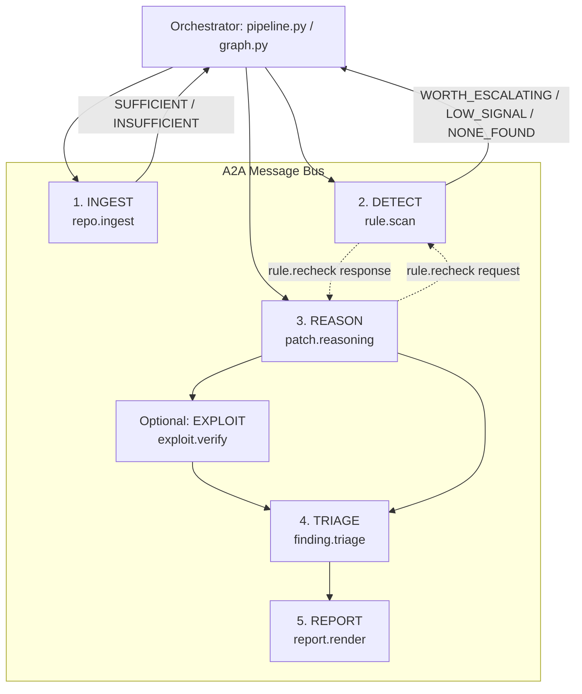

# Autonomous Cybersecurity Analyst AI — Project Architecture & Onboarding Guide

> **Target Audience:** Engineering team members, security analysts, and new contributors.  
> **Repository:** `cybersecurity-analyst-ai`  
> **Tech Stack:** Python 3.12, LangGraph, Tree-sitter, FastAPI, Pydantic, Groq (via LangChain), Click, Rich.

---

## 1. Executive Summary

The **Autonomous Cybersecurity Analyst AI** is an agentic, end-to-end security pipeline that scans source code for security vulnerabilities, confirms candidate findings, generates remediation patches, **empirically validates fixes inside an isolated sandbox**, and produces cryptographically verifiable audit reports.

### Key Innovations
* **Autonomous Sandbox Patch-Verification:** The system doesn't assume an LLM-suggested fix works. It clones the vulnerable code to a temporary sandbox, applies the patch, and prompts the Detection engine to confirm the vulnerability rule no longer triggers.
* **Agent-to-Agent (A2A) Capability Bus:** Agents never directly import or invoke one another. Handoffs occur over a typed, signed message bus ([analyst/protocol/bus.py](file:///c:/Users/kruna/cybersecurity-analyst-ai/analyst/protocol/bus.py)) using capability lookups (e.g. `rule.recheck`, `patch.reasoning`).
* **Cryptographic Chain of Custody:** Each scan generates a unique run salt. Every message, state transition, and routing decision is recorded in an HMAC-chained audit log ([analyst/protocol/crypto.py](file:///c:/Users/kruna/cybersecurity-analyst-ai/analyst/protocol/crypto.py)), sealed with a verification sidecar (`.integrity.json`).
* **Deterministic Fallback & Zero-Key Operation:** Can run 100% offline without API keys (`--offline`). If LLM limits or network interruptions occur, the pipeline gracefully degrades to deterministic regex and template engines.

---

## 2. High-Level Architecture

The system is coordinated either by a deterministic linear orchestrator or a LangGraph state graph. Both run the exact same agents and preserve the same peer communication contracts.



---

## 3. The Autonomous Agents

| Agent | Capability | Source Module | Primary Responsibility |
|---|---|---|---|
| **INGEST** | `repo.ingest` | [analyst/ingestion/agent.py](file:///c:/Users/kruna/cybersecurity-analyst-ai/analyst/ingestion/agent.py) | Walks local directories or shallow-clones remote Git repos. Parses ASTs using Tree-sitter & Python `pyclbr`. Evaluates manifest quality (`SUFFICIENT` vs `INSUFFICIENT`). |
| **DETECT** | `rule.scan`<br/>`rule.recheck` | [analyst/detection/agent.py](file:///c:/Users/kruna/cybersecurity-analyst-ai/analyst/detection/agent.py) | Executes AST taint-walking, regexes, and entropy detectors catalogued in [rules.yaml](file:///c:/Users/kruna/cybersecurity-analyst-ai/analyst/detection/rules.yaml). Masks secrets at inception. Provides `rule.recheck` to test patched files. |
| **REASON** | `patch.reasoning` | [analyst/reasoning/patch_loop.py](file:///c:/Users/kruna/cybersecurity-analyst-ai/analyst/reasoning/patch_loop.py) | Uses Groq LLM (with deterministic regex fallback). Confirms issues, proposes git diffs, executes sandbox patching, and re-checks with DETECT. Max 2 retry loops. |
| **EXPLOIT** | `exploit.verify` | [analyst/exploitation/agent.py](file:///c:/Users/kruna/cybersecurity-analyst-ai/analyst/exploitation/agent.py) | *(Optional via `--dynamic`)* Spawns a sandboxed subprocess and executes active HTTP attack payloads before and after patching to dynamically prove fix validity. |
| **TRIAGE** | `finding.triage` | [analyst/triage/agent.py](file:///c:/Users/kruna/cybersecurity-analyst-ai/analyst/triage/agent.py) | Scores findings into priorities `P1` through `P4`. Unresolved/unfixed critical vulnerabilities are ranked higher urgency than vulnerabilities with verified fixes ready to merge. |
| **REPORT** | `report.render` | [analyst/reporting/agent.py](file:///c:/Users/kruna/cybersecurity-analyst-ai/analyst/reporting/agent.py) | Generates clean Markdown, HTML, or PDF reports ([export.py](file:///c:/Users/kruna/cybersecurity-analyst-ai/analyst/reporting/export.py)) with provenance summaries and cryptographic signatures. |

---

## 4. Codebase Directory Structure

```
cybersecurity-analyst-ai/
│
├── analyst/                               # Core Application Package
│   ├── __main__.py                       # Click CLI entrypoint
│   │
│   ├── common/                           # Shared models & utilities
│   │   ├── types.py                      # CandidateFinding, ConfirmedFinding, status enums
│   │   ├── redact.py                     # Secrets scrubbing and redaction
│   │   └── parallel.py                   # ThreadPool execution helper
│   │
│   ├── protocol/                         # Agent-to-Agent (A2A) Communication Layer
│   │   ├── bus.py                        # MessageBus router & capability registry
│   │   ├── envelope.py                   # AgentMessage envelopes & typed payloads
│   │   └── crypto.py                     # SaltContext, HMAC-SHA256 signature chain & AuditLog
│   │
│   ├── ingestion/                        # Codebase ingestion & parsing
│   │   ├── agent.py                      # Ingestion agent (Self-assesses parse ratio)
│   │   ├── manifest.py                   # AST routing, Tree-sitter extraction, file hashing
│   │   ├── repo_fetcher.py               # Local directory & Git URL shallow-clone handling
│   │   └── scan_cache.py                 # Incremental baseline diffing & caching
│   │
│   ├── detection/                        # Static analysis & rule engine
│   │   ├── agent.py                      # Detection agent & rule.recheck provider
│   │   ├── engine.py                     # AST taint-tracking, pattern checks & entropy rules
│   │   ├── rules_extra.py                # Additional vulnerability rules
│   │   └── rules.yaml                    # Authoritative catalogue of active/inactive rules
│   │
│   ├── reasoning/                        # LLM reasoning & sandbox patch-verify loop
│   │   ├── patch_loop.py                 # Propose -> Act -> Observe -> Decide closed loop
│   │   ├── engine.py                     # Groq LLM integration & prompt synthesis
│   │   ├── confidence.py                 # Multi-factor confidence calibration
│   │   └── fallback.py                   # Deterministic offline regex & template patching
│   │
│   ├── exploitation/                     # Dynamic exploit verification
│   │   └── agent.py                      # Sandboxed HTTP exploit execution harness
│   │
│   ├── triage/                           # Urgency & fix prioritization
│   │   └── agent.py                      # Deterministic P1-P4 triage engine
│   │
│   ├── reporting/                        # Report rendering & exporting
│   │   ├── agent.py                      # Reporting agent
│   │   ├── renderer.py                   # Markdown report builder & redactor
│   │   └── export.py                     # PDF (WeasyPrint) & HTML export generator
│   │
│   ├── orchestrator/                     # Pipeline execution engines
│   │   ├── pipeline.py                   # Linear procedural pipeline
│   │   └── graph.py                      # LangGraph StateGraph pipeline
│   │
│   └── api/                              # REST & WebSocket Web Dashboard
│       ├── app.py                        # FastAPI endpoints & real-time socket events
│       ├── manager.py                    # Background scan task manager
│       └── static/                       # UI assets (HTML, CSS, JS dashboard)
│
├── demo_app/                             # Sample vulnerable Python Flask application
├── demo_app_jsts/                        # Sample vulnerable JavaScript / TypeScript application
├── Document/                             # Formal specifications & architecture docs
│   ├── ARCHITECTURE_A2A.md               # Detailed A2A protocol specifications
│   ├── rules.md                          # Vulnerability rule catalogue documentation
│   └── design.md                         # Original design & threat model
├── tests/                                # Pytest test suite (100% offline runnable)
├── scripts/
│   └── compute_metrics.py                # Metric evaluation (Precision, Recall, FP reduction)
├── requirements.txt                      # Project dependencies
└── pyproject.toml                        # Project metadata
```

---

## 5. Core Architectural Concepts

### 5.1 The Closed-Loop Patch Verification Cycle
Rather than open-loop patch generation, the REASON agent executes:
1. **PROPOSE:** Query LLM (or deterministic templates) for candidate patch diff.
2. **ACT:** Apply patch to a temporary sandboxed directory via `tempfile.mkdtemp`.
3. **OBSERVE:** Send `RuleRecheckRequest` over the A2A bus to DETECT.
4. **DECIDE:**
   * Rule no longer triggers $\rightarrow$ **`ACCEPTED`** (verified fix).
   * Rule still triggers, retries left $\rightarrow$ **`RETRY`** (send error feedback back to LLM).
   * Out of attempts $\rightarrow$ **`MANUAL_REVIEW_REQUIRED`** (unverified patch is stripped; safe advice is supplied).

### 5.2 Cryptographic Chain of Custody
* Every scan initializes a `SaltContext`.
* Each inter-agent message is packaged in an `AgentMessage` envelope signed with HMAC-SHA256.
* Transitions are appended to an `AuditLog` where each record hashes the previous record.
* Final reports are saved alongside a `.integrity.json` checksum sidecar.

### 5.3 Deterministic Degradation
The system adheres to an "offline first" design. If no `GROQ_API_KEY` is present or the `--offline` flag is passed:
* REASON invokes [fallback.py](file:///c:/Users/kruna/cybersecurity-analyst-ai/analyst/reasoning/fallback.py).
* Deterministic regex confirmation and pre-audited template patches are generated.
* The report explicitly indicates `DEGRADED RUN` for transparency.

---

## 6. How to Run the Project

### Environment Setup
```bash
# Create and activate virtual environment
python -m venv .venv
source .venv/bin/activate       # On Windows: .venv\Scripts\activate

# Install dependencies
pip install -r requirements.txt

# (Optional) Add Groq key for LLM reasoning
cp .env.example .env
# Set GROQ_API_KEY=your_key in .env
```

### CLI Scan Commands
```bash
# 1. Offline scan (default linear engine)
python -m analyst scan demo_app --offline -o report.md --artifacts artifacts/

# 2. LLM-augmented scan
python -m analyst scan demo_app -o report.md --artifacts artifacts/

# 3. LangGraph orchestrator engine
python -m analyst scan demo_app --offline --engine graph -o report.md

# 4. Exporting as HTML or PDF
python -m analyst scan demo_app --offline -o report.md --format html
python -m analyst scan demo_app --offline -o report.md --format pdf

# 5. Incremental scan (only scan changed files)
python -m analyst scan demo_app --offline --incremental -o report.md

# 6. Dynamic exploit verification
python -m analyst scan demo_app --dynamic -o report.md
```

### Web Dashboard
```bash
# Launch FastAPI backend & web UI
uvicorn analyst.api.app:app --port 8000
# Open browser at http://localhost:8000
```

### Running Test Suite
```bash
# All tests run offline and mock external APIs
pytest tests/ -v
```

---

## 7. Recommended Reading Order for New Developers

1. [analyst/orchestrator/pipeline.py](file:///c:/Users/kruna/cybersecurity-analyst-ai/analyst/orchestrator/pipeline.py) — Start here to see the pipeline end-to-end.
2. [analyst/reasoning/patch_loop.py](file:///c:/Users/kruna/cybersecurity-analyst-ai/analyst/reasoning/patch_loop.py) — Understand sandbox patching and peer verification.
3. [analyst/protocol/bus.py](file:///c:/Users/kruna/cybersecurity-analyst-ai/analyst/protocol/bus.py) & [analyst/protocol/envelope.py](file:///c:/Users/kruna/cybersecurity-analyst-ai/analyst/protocol/envelope.py) — Understand A2A messaging and typing.
4. [analyst/detection/engine.py](file:///c:/Users/kruna/cybersecurity-analyst-ai/analyst/detection/engine.py) & [rules.yaml](file:///c:/Users/kruna/cybersecurity-analyst-ai/analyst/detection/rules.yaml) — Understand how AST taint-analysis and rules operate.
5. [Document/ARCHITECTURE_A2A.md](file:///c:/Users/kruna/cybersecurity-analyst-ai/Document/ARCHITECTURE_A2A.md) — For deep theoretical background and protocol verification.
